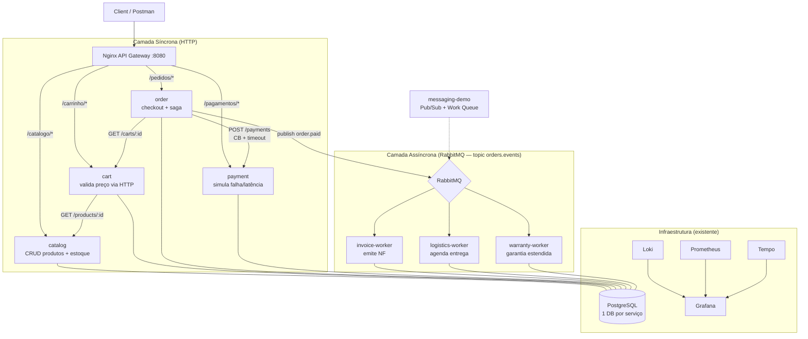

# 🛒 Plano — Lab de Microsserviços (E-commerce)

> Transformar o monólito `python-api` em um laboratório de microsserviços com **8 serviços**, cobrindo comunicação síncrona (HTTP), assíncrona (eventos), API Gateway, Database-per-Service, resiliência e observabilidade de ponta a ponta.

## Visão Geral das Decisões

| Decisão | Escolha |
|---|---|
| Estrutura do repositório | Monorepo: `services/` + `shared/` (biblioteca comum) |
| Camada de entrada | Nginx como API Gateway (`:8080`) |
| Persistência | 1 container PostgreSQL → **1 database por serviço** |
| Entrega | Por fases: core síncrono → eventos assíncronos → gateway/polish |
| Código atual (`python-api`) | Vira o serviço de exemplo `services/messaging-demo` |

---

## 🎯 Arquitetura-Alvo



### Fluxo de negócio (happy path)

1. `POST /carrinho/:id/items` → cart valida produto/preço no catálogo (HTTP)
2. `POST /pedidos` → order busca carrinho → cria pedido `PENDING` → cobra pagamento (HTTP + Circuit Breaker)
3. Pagamento OK → pedido `PAID` → publica evento `order.paid` no topic exchange
4. invoice-worker emite NF e publica `invoice.issued`
5. logistics-worker agenda a entrega
6. warranty-worker registra garantia estendida (apenas produtos elegíveis)
7. Pagamento falhou → pedido `REJECTED` → publica `order.rejected` → workers ignoram (compensação)

---

## 📁 Estrutura de Pastas

```
logs-with-loki/
├── docker-compose.yml              # infra + todos os serviços
├── .env.example
├── config/
│   ├── nginx/nginx.conf            # [novo] API Gateway
│   ├── postgres/init.sql           # [novo] cria databases por serviço
│   ├── loki/  ├── grafana/  ├── prometheus/  ├── tempo/
├── shared/                         # [novo] biblioteca comum instalável
│   ├── pyproject.toml
│   └── lab_common/
│       ├── __init__.py
│       ├── logger.py               # JSON + contexto OTel (extraído do src atual)
│       ├── tracing.py              # init_tracing(service_name) + get_tracer()
│       ├── rabbitmq.py             # topologia declarativa + publish W3C
│       ├── worker.py               # [novo] retry/DLQ/idempotência/metrics server
│       ├── http_client.py          # [novo] requests + timeout + CB por downstream
│       ├── db.py                   # [novo] session factory por DATABASE_URL
│       └── health.py               # [novo] blueprint /health/live + /health/ready
├── services/
│   ├── messaging-demo/             # renomeado de python-api (refatorado p/ lab_common)
│   ├── catalog/                    # API Flask — produtos
│   ├── cart/                       # API Flask — carrinho
│   ├── order/                      # API Flask — pedidos + publicador de eventos
│   ├── payment/                    # API Flask — pagamentos simulados
│   ├── invoice/                    # worker assíncrono — emissão de NF
│   ├── logistics/                  # worker assíncrono — entrega
│   └── warranty/                   # worker assíncrono — garantia estendida
├── scripts/
│   ├── seed_catalog.sql            # produtos de exemplo
│   ├── smoke_test.sh               # fluxo end-to-end via gateway
│   └── demo_flow.sh                # cenário de aula
└── docs/                           # Postman + classroom guide atualizados
```

### Convenções de build (Docker)

- Build context **sempre na raiz** do repositório:

```yaml
catalog:
  build:
    context: .
    dockerfile: services/catalog/Dockerfile
```

- Cada Dockerfile copia `shared/` + seu serviço e roda `pip install ./shared -r service/requirements.txt`
- CMD alinhado para `python app.py` (elimina a ambiguidade do `flask run` + `FLASK_APP`)
- Base image e versões de dependências **mantidas** (Python 3.10, Flask, OTel 1.30) para não quebrar a instrumentação existente

---

## 📦 Topologia de Eventos (RabbitMQ)

| Elemento | Nome | Tipo | Observação |
|---|---|---|---|
| Exchange | `orders.events` | topic | Publicado pelo order-service |
| Routing keys | `order.paid`, `order.rejected`, `invoice.issued` | — | — |
| Queues | `invoice.order_paid`, `logistics.order_paid`, `warranty.order_paid` | durable | Cada worker tem a sua, bind por routing key |
| DLQ | `orders_dlq` | direct | nack sem requeue → DLQ (padrão já existente) |
| Headers | W3C Trace Context + `correlationId` | — | Propagação de ponta a ponta (já implementada) |

Os workers reutilizam o padrão do `consumer.py` atual: **retry com backoff exponencial** (3 tentativas), **idempotência** e **DLQ** — tudo embutido em `lab_common.worker.run_worker()`.

---

## 🗺️ Fases de Implementação

### Fase 0 — Fundação: `shared/` + reestruturação

> Sem mudança de comportamento: o lab atual deve continuar funcionando igual.

- [ ] Criar `shared/lab_common/` extraindo o `python-api/src/`:
  - [ ] `logger.py` — idêntico ao atual (JSON + `traceId`/`spanId`)
  - [ ] `tracing.py` — já parametrizado por `service_name`
  - [ ] `rabbitmq.py` — generalizar: `declare_topology()`, `publish(exchange, routing_key, msg, correlation_id)` com injeção W3C, `consume(queue, callback)`
  - [ ] `worker.py` — helper `run_worker(queue, handler, metrics_port)` com retry+backoff, DLQ, idempotência e `start_http_server`
  - [ ] `http_client.py` — `call(downstream, ...)` com `requests` + timeout + Circuit Breaker por serviço (pybreaker)
  - [ ] `db.py` — `create_session_factory()` lendo `DATABASE_URL` do env
  - [ ] `health.py` — blueprint com `/health/live` + `/health/ready` (postgres + rabbitmq opcional)
  - [ ] `pyproject.toml` para `pip install ./shared`
- [ ] Mover `python-api/` → `services/messaging-demo/` refatorando para importar de `lab_common`
- [ ] Dockerfiles com context na raiz (`context: .`)
- [ ] Atualizar `docker-compose.yml` (build contexts do messaging-demo)
- [ ] **Validação**: `docker compose up -d` → `POST /message` e `POST /task` funcionando, traces no Tempo e logs no Loki idênticos aos de hoje

### Fase 1 — Core síncrono: catálogo, carrinho, pedido, pagamento

- [ ] **catalog** (`catalog_db`):
  - [ ] CRUD `GET /products`, `GET /products/:id`, `POST /products`, `PUT /products/:id`
  - [ ] Campos: `name`, `price`, `stock`, `extended_warranty_eligible`
  - [ ] Seed em `scripts/seed_catalog.sql` (~5 produtos, 1 ou 2 elegíveis a garantia)
- [ ] **payment** (`payment_db`):
  - [ ] `POST /payments` → `PENDING → APPROVED/REJECTED`
  - [ ] `PAYMENT_FAILURE_RATE` (default ~0.2) e `PAYMENT_LATENCY_MS` via env — falha/latência didática p/ Circuit Breaker
- [ ] **cart** (`cart_db`):
  - [ ] `POST /carts/:id/items`, `GET /carts/:id`, `DELETE /carts/:id/items/:product_id`
  - [ ] Valida produto/preço no catálogo via `lab_common.http_client` (CB + timeout 2s)
- [ ] **order** (`order_db`):
  - [ ] `POST /orders` → `GET /carts/:id` → cria pedido `PENDING` → `POST /payments` (CB + timeout) → `PAID` ou `REJECTED`
  - [ ] `GET /orders/:id`; métrica `orders_created_total{status}`
- [ ] `config/postgres/init.sql` criando: `catalog_db`, `cart_db`, `order_db`, `payment_db`, `messages_db`
- [ ] Compose: +4 serviços com env vars (`DATABASE_NAME`, `POSTGRES_HOST`, `RABBITMQ_HOST`, `TEMPO_ENDPOINT`, etc.)
- [ ] Prometheus: 4 novos jobs (uma porta/serviço via `/metrics`)
- [ ] **Validação**: `scripts/smoke_test.sh` cobrindo catálogo → carrinho → pedido → pagamento; coleção Postman atualizada

### Fase 2 — Eventos assíncronos: NF, logística, garantia

- [ ] Topologia de eventos: exchange topic `orders.events` + queues + `orders_dlq` (em `lab_common`/compose)
- [ ] **order** publica `order.paid` (W3C headers + correlationId) após pagamento OK e `order.rejected` na falha
- [ ] **invoice-worker** (`invoice_db`):
  - [ ] Consome `order.paid` → simula emissão (latência 2–3s) → persiste número de NF sequencial
  - [ ] Publica `invoice.issued`
  - [ ] Falha simulada ocasional (~20%) → demonstra retry + DLQ
- [ ] **logistics-worker** (`logistics_db`): consome `order.paid` → cria entrega `SCHEDULED`
- [ ] **warranty-worker** (`warranty_db`):
  - [ ] Consome `order.paid` → enriquece com dados do catálogo (HTTP)
  - [ ] Registra garantia estendida **apenas** se item tiver `extended_warranty_eligible=true`
- [ ] Os 3 workers usam `lab_common.worker.run_worker()` (retry/DLQ/idempotência grátis)
- [ ] Prometheus: jobs `dns_sd` por worker; dashboard com painéis de eventos e DLQ
- [ ] **Validação**: um `POST /pedidos` gera um trace único no Tempo (HTTP → evento → 3 workers); mesma `correlationId` consultável no Loki

### Fase 3 — Gateway, resiliência e polish

- [x] **Nginx API Gateway** (`:8080`):
  - [x] Roteia `/catalogo/*` → catalog, `/carrinho/*` → cart, `/pedidos/*` → order, `/pagamentos/*` → payment
  - [ ] `/docs` de cada serviço acessível via path (Swagger)
  - [x] Gera/propaga `X-Correlation-ID`
  - [x] Rate limit simples (didático)
- [x] **Resiliência reforçada**:
  - [x] Timeouts explícitos em todas as chamadas inter-serviço
  - [x] Demo em aula: `PAYMENT_FAILURE_RATE=1.0` + derrubar payment → pedido rejeita rápido com 503 (CB aberto)
- [x] **Compensação didática**: `order.rejected` → logistics/warranty registram `IGNORED` (saga simplificada)
- [ ] Dashboard Grafana reorganizado por serviço (RED + containers + filas + eventos)
- [ ] `scripts/demo_flow.sh` (cenário de aula) e `test_load.py` adaptado para o fluxo de pedidos
- [ ] Atualizar `README.md`, `docs/classroom_guide.md` e coleção do Postman; diagrama mermaid final

---

## 🧠 Conceitos Cobertos pelo Lab Final

| Conceito | Onde ver na prática |
|---|---|
| API Gateway | Nginx roteando por path + rate limit |
| Database-per-Service | 7 databases no PostgreSQL, cada serviço só acessa o seu |
| Comunicação síncrona (HTTP) | cart→catalog, order→cart, order→payment |
| Comunicação assíncrona (eventos) | order→(invoice, logistics, warranty) via topic exchange |
| Pub/Sub vs Work Queue | messaging-demo (fanout vs direct) — referência didática |
| Circuit Breaker entre serviços | order→payment e cart→catalog via `lab_common.http_client` |
| Saga / compensação | `order.rejected` → workers ignoram/registram IGNORED |
| DLQ + Retry c/ Backoff | workers da Fase 2 + messaging-demo |
| Idempotência | `lab_common.worker` (cache por correlationId) |
| Correlation ID + W3C Trace Context | gateway → HTTP → evento → worker → banco |
| Health Checks | blueprint compartilhado `/health/live` + `/health/ready` |
| Observabilidade (3 pilares) | Loki + Prometheus + Tempo com 12+ processos |
| Escalabilidade horizontal | workers replicáveis + `dns_sd` no Prometheus |

---

## ⚠️ Riscos e Mitigações

| Risco | Mitigação |
|---|---|
| `docker-compose.yml` crescer muito (~400+ linhas) | Âncoras YAML (`x-app-defaults`) para env/logging/restart comuns |
| Build context raiz copiando tudo | `.dockerignore` na raiz excluindo `.git`, `docs`, `config` |
| Conflito de porta dos workers (metrics) | Cada worker no seu container: todos usam `8000` internamente, `dns_sd` por nome |
| Duplicação entre serviços (copiar/colar) | `lab_common` cobre logger/tracing/rabbitmq/worker/http/db/health — serviço só tem regra de negócio |
| Quebra do lab atual na Fase 0 | Critério de validação explícito: `/message` e `/task` devem continuar iguais antes de avançar |
| Portas dos serviços no host | Serviços **não** expõem porta no host; só o gateway (`8080`) — debug via `docker compose exec` ou Swagger pelo gateway |

---

## ✅ Ordem de Execução Recomendada

1. **Fase 0** primeiro — destrava tudo o resto e garante reutilização
2. **Fase 1** — 4 serviços síncronos validados juntos com `smoke_test.sh`
3. **Fase 2** — 3 workers assíncronos + topologia de eventos
4. **Fase 3** — gateway + resiliência + dashboards + docs

> Cada fase termina com o lab **100% funcional** (`docker compose up -d` + critérios de validação), permitindo pausar e retomar a qualquer momento.

---

# 📋 Continuação — Avaliação Pós-Fase 3 e Próximas Fases

> Estado verificado em `git log` até o commit **9623405 ("fase 3 com gateway")**. As Fases 0–3 foram entregues, mas uma auditoria do repositório revela **lacunas que impedem o projeto de funcionar como laboratório de arquitetura de microsserviços no nível do mercado atual**. Abaixo, o diagnóstico e a fila de trabalho restante.

## 🔍 Diagnóstico do Estado Atual

### ✅ Entregue e funcional

| Item | Local |
|---|---|
| 8 serviços no compose (catalog, cart, order, payment, invoice, logistics, warranty, messaging-demo) | `docker-compose.yml` |
| Biblioteca compartilhada `lab_common` (logger, tracing, rabbitmq, worker, http_client, db, health) | `shared/lab_common/` |
| Database-per-service | `postgres` + `dns` de cada serviço |
| Fluxo síncrono cart→catalog e order→cart→payment | serviços core |
| Topologia de eventos (`orders.events` topic + 3 filas + DLQ) | workers + `order/app.py` |
| API Gateway Nginx com rate limit e `X-Request-ID` | `config/nginx/nginx.conf` |
| Observabilidade base (Loki, Prometheus, Tempo, Grafana) | `config/` |

### ❌ Lacunas críticas (quebram conceitos centrais da aula)

| # | Problema | Impacto | Status |
|---|---|---|---|
| C1 | **Prometheus não coleta os novos serviços** (só messaging-demo antigo) | microserviços não aparecem em métricas | ✅ resolvido (Fase 4) |
| C2 | **Circuit Breaker não funciona** (`pybreaker` criado a cada chamada, nunca acumula falha) | demo de resiliência falsa | ✅ resolvido (Fase 4) |
| C3 | **Tracing quebrado entre chamadas HTTP** (`requests` sem W3C) | trace para de atravessar serviços | ✅ resolvido (Fase 4) |
| C4 | **`init.sql` incompleto + falha em redeploy** (DBs core criados manualmente) | clone do zero perde databases | ✅ resolvido (Fase 4) |

### ⚠️ Lacunas de qualidade/mercado (não quebram, mas afastam do "mundo real")

| # | Problema | Por que importa | Status |
|---|---|---|---|
| Q1 | **Sem Outbox / mensageria transacional** (`publish` depois do commit) | padrão obrigatório em sistemas de pedidos | ✅ resolvido (Fase 5) |
| Q2 | **Idempotência só em memória** (sem constraint `unique`) | não sobrevive a restart/replica | ✅ resolvido (Fase 5) |
| Q3 | **`order.rejected` não é consumido** — saga só narrativa | compensação é tema cobrado no mercado | ✅ resolvido (Fase 5) |
| Q4 | **`README.md` e `docs/classroom_guide.md` desatualizados** — ainda descrevem só o lab antigo de observabilidade, sem os 8 serviços | Aluno novo não sabe nem o que existe |
| Q5 | **Validação de entrada ausente** nos serviços novos (só `request.get_json()`). `marshmallow`/apiflask só no messaging-demo | Contrato/validação de payload é básico |
| Q6 | **Sem CI/CD** (nenhum workflow GitHub Actions), sem lint, sem testes | Mercado atual = PR validado por pipeline |
| Q7 | **Sem versionamento de API** (`/api/v1/`) e sem autenticação no gateway | Diferença entre API pública/privada e versioning |
| Q8 | Seed de catálogo **manual** (`docker exec`). `scripts/seed_catalog.sql` não é aplicado automaticamente | Repro lab deve ser 1 comando |
| Q9 | `.env.example` não cobre as novas vars (`PAYMENT_FAILURE_RATE`, `PAYMENT_LATENCY_MS`, `INVOICE_FAIL_RATE`, URLs) — tudo hardcoded no compose | Princípio 12-factor (config no ambiente) |
| Q10 | **Artefatos de build commitados** (`shared/build/`, `shared/*.egg-info/`, `__pycache__/`, `services/cart/shared/` vazio) e `.gitignore` insuficiente | Higiene de repo |
| Q11 | `services/messaging-demo/src/` ainda tem código duplicado (logger/rabbitmq/tracing velhos) além de `database.py`/`schemas.py` legados | Consistência: ou tudo em `lab_common`, ou o exemplo fica confuso |
| Q12 | Painel Grafana `microservices.json` reflete só o messaging-demo antigo | Não há dashboard por serviço novo (RED, `orders_created_total{status}`, workers, DLQs) |
| Q13 | Sem scripts de demonstração prontos: carga (`test_load` aponta para `:5000/message` antigo), e nenhum script de caos (derrubar payment, escalar workers) | Aula precisa de "botão" para cada demo |
| Q14 | `X-Request-ID` do gateway não é reutilizado como `correlationId` de negócio nos serviços | Conceito de correlation ID de ponta a ponta fica frouxo |

---

## 🗺️ Fases Seguintes

> Ordens por prioridade de impacto didático. Cada fase é independente e termina em estado funcional.

### Fase 4 — Corrigir os pilares de observabilidade e resiliência (críticos) ✅ RESOLVIDA

- [x] **Prometheus**: adicionar jobs static para `catalog:5000`, `cart:5000`, `order:5000`, `payment:5000` e `dns_sd` para `invoice-worker`, `logistics-worker`, `warranty-worker` (porta 8000)
- [x] **http_client**: Circuit Breaker **persistente por downstream** (dicionário `{nome: breaker}` na instância) e **injeção de contexto W3C** (`propagate.inject` nos headers) — reaproveitar o padrão já usado no RabbitMQ
- [x] **init.sql**: listar os 7 databases (core + workers); documentar `docker compose down -v` para reset e criar um `scripts/reset_db.sh` que cria os DBs sem apagar o volume
- [x] **Critério de validação**: 9/10 targets `up` no Prometheus (só `cadvisor` down no macOS); trace único no Tempo (W3C injetado no HTTP confirmado); CB abriu após `fail_max=2` e passou a rejeitar com `CircuitBreakerError` imediato

> **Anotação (dívida técnica descoberta)**: o Nginx falha em iniciar se um upstream estiver parado (`host not found in upstream`). Movida para a Fase 7 como *gateway resiliente* (resolver Docker DNS + `proxy_pass` por variável).

### Fase 5 — Confiabilidade de produção (Outbox, idempotência real, saga) ✅ RESOLVIDA

- [x] **Outbox pattern** no `order`: tabela `outbox_events` **no mesmo commit** do pedido; um relay em background (thread) publica no RabbitMQ e marca como `published` — *at-least-once* na publicação de `order.paid`/`order.rejected`
- [x] **Idempotência persistente**: `unique` constraint em `order_id` (invoice), `(order_id, product_id)` (warranty) + checagem/upsert no handler — em vez de set em memória
- [x] **Consumir `order.rejected`**: compensation (`order.rejected`) → logistics marca `CANCELLED`; warranty `SKIPPED`; catálogo devolve estoque via `POST /products/:id/release`
- [x] **Saga com reserva de estoque**: catálogo ganhou `POST /products/:id/reserve` e `/release`; order reserva estoque antes do pagamento e libera na rejeição
- [x] **Critério de validação**: happy path (PAID) → estoque decrementado, outbox `published=true`, invoice/delivery/warranty criados; rejeição (payment parado) → estoque devolvido, `order.rejected` no outbox, sem delivery/warranty; evento `order.paid` duplicado republicado → **1** invoice (idempotente)

> **Nota de migração**: `create_all` não altera tabelas existentes; em volume pré-existente, aplicar `ALTER TABLE ... UNIQUE` manual (feito neste ambiente) ou `docker compose down -v` para recreatedo zero.

### Fase 6 — Contrato, gateway e demonstração

- [ ] **Validação com marshmallow/apiflask** (`@app.input` + schemas) nos 4 serviços core, com OpenAPI (`/docs`) exposto via gateway
- [ ] **Versionamento** `/api/v1/*` nos serviços e no Nginx
- [ ] **`X-Correlation-ID`→`correlationId` de negócio**: middleware compartilhado que lê o header (ou gera) e usa como correlation id nos logs/spans/subsequentes
- [ ] **Seed automático** do catálogo (idempotente no startup do catalog ou init container)
- [ ] **Dashboard Grafana** reorganizado: RED por serviço + `orders_created_total{status}` + contadores dos workers + DLQ por fila
- [ ] **Scripts de aula**: `scripts/demo_flow.sh` (happy path), `scripts/demo_chaos.sh` (derrubar payment, escalar `--scale`, encher DLQ), `scripts/load_orders.sh`
- [ ] **Coleção Postman** reorganizada por domínio (catálogo, carrinho, pedidos, observabilidade)
- [ ] **Critério de validação**: `./scripts/demo_flow.sh` roda de ponta a ponta sem passos manuais

### Fase 7 — Documentação, CI e higiene

- [ ] **README.md** reescrito: arquitetura (mermaid), tabela dos 8 serviços, portas/gateway, `docker compose down -v` e como rodar cada demo
- [ ] **docs/classroom_guide.md**: roteiro de aula reescrito para o fluxo de e-commerce (síncrono + assíncrono + falhas), com perguntas de discussão (trade-offs)
- [ ] **CI** (GitHub Actions): job de lint (`ruff`/`flake8`), build das imagens e `smoke_test.sh`
- [ ] **.env.example** completo + refatorar compose para usar âncoras `x-app` e env vars (remover hardcode)
- [ ] **`.gitignore`** + limpar `build/`, `*.egg-info/`, `__pycache__/`, `services/*/shared/`, `services/cart/shared/`
- [ ] **Unificar `messaging-demo/src/`**: migrar `database.py`/`schemas.py` para `lab_common` ou deixar explícito no README que é o "exemplo legado" — sem código morto duplicado
- [ ] **Critério de validação**: clone limpo → `cp .env.example .env && docker compose up -d --build` → `/health/ready` de tudo UP → `demo_flow.sh` verde → CI verde

---

## 📊 Relevância para o Mercado Atual (checklist final)

| Tema de mercado | Status no lab |
|---|---|
| Comunicação síncrona vs eventos | ✅ implementado |
| Database-per-service | ✅ implementado |
| API Gateway + rate limit | ✅ (falta auth na Fase 6) |
| Observabilidade 3 pilares | ✅ corrigido (Fase 4) |
| Distributed tracing end-to-end | ✅ corrigido (Fase 4) |
| Circuit Breaker + timeout | ✅ corrigido (Fase 4) |
| Outbox / mensageria transacional | ✅ Fase 5 |
| Idempotência durável | ✅ Fase 5 |
| Saga / compensação | ✅ Fase 5 |
| Validação de contrato / OpenAPI | ⚠️ Fase 6 |
| CI/CD + lint | ❌ Fase 7 |
| Config por ambiente (12-factor) | ⚠️ Fase 7 |

> **Conclusão da auditoria**: a estrutura de microserviços está correta e os fluxos funcionam, mas o lab ainda **não ensina de verdade** três pilares prometidos (métricas por serviço, circuit breaker, tracing entre serviços) e não cobre padrões de produção essenciais (outbox, idempotência durável, saga, CI). Com as Fases 4–7, o projeto fica condizente com "arquitetura no mercado atual" para alunos de Ciência da Computação na USP.
